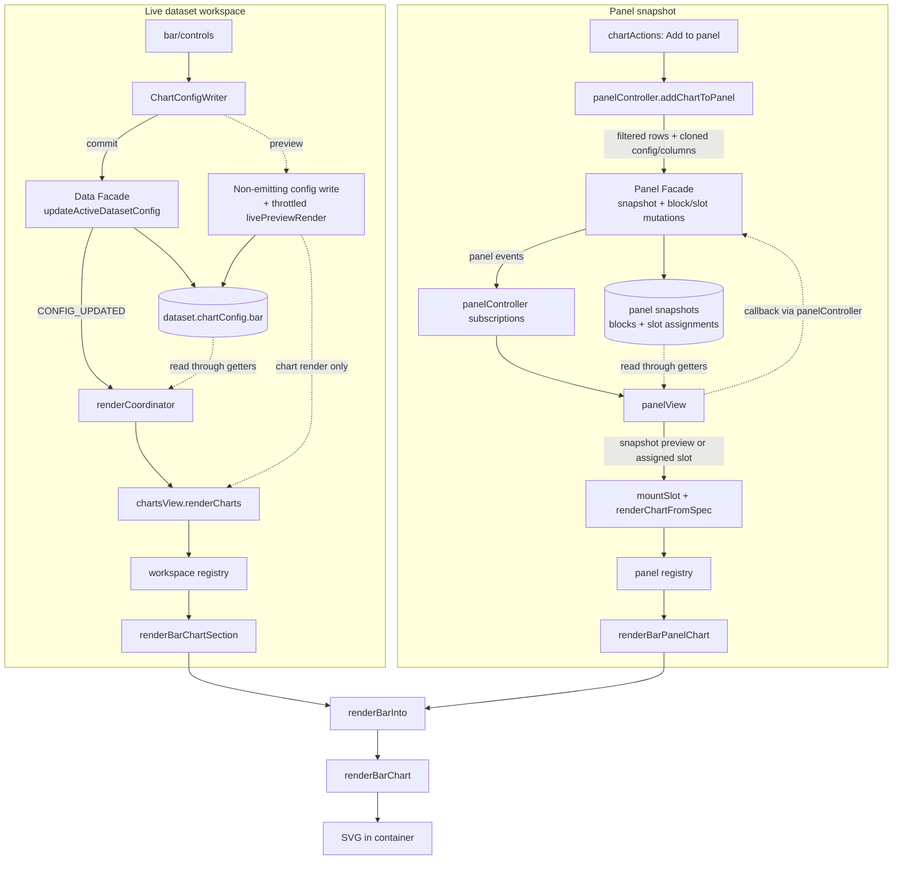

# The Bar Chart, end to end

This document explains how CHIVE's bar chart works, from the config a dataset stores,
through the sidebar controls, into the renderer, and out to the panel/export paths. It is
meant to be read top to bottom the first time and used as a reference afterwards. File
links are relative to this document (which lives in `docs/development/charts/`).

Section 2 covers the data-transformation and encoding ideas the chart rests on (what a bar
chart *is*, independent of this codebase); everything from section 3 onward is how CHIVE
implements it.

For the high-level "which columns does it need" summary, see the bar row in
[Chart and data reference](../../user/chart-reference.md). For the shared state/panel/event architecture,
see [Architecture reference](../architecture-reference.md).

---

## 1. What a bar chart is

A bar chart compares a single measure across a set of categories. Each distinct value of a
categorical column becomes one vertical bar, and the bar's height encodes a number derived
from the rows in that category: how many rows there are (count), or the total or average of
a second numeric column (sum, mean).

It is the most "aggregating" of the charts: it collapses many rows into one bar per
category, so the transformation from rows to bars (grouping plus a reducer) is the heart of
it. On top of the bars it offers sorting, Top-N trimming, three color encodings, and
click-to-filter interactions shared with the other categorical charts.

Key files:

- Package root: [src/charts/bar/](../../../src/charts/bar)
- Renderer: [renderers/svg.js](../../../src/charts/bar/renderers/svg.js)
- Data, options, and color logic: [data.js](../../../src/charts/bar/data.js),
  [options.js](../../../src/charts/bar/options.js), and
  [color.js](../../../src/charts/bar/color.js)
- Sidebar controls: [controls/](../../../src/charts/bar/controls)
- Chart definition and constants: [bar.js](../../../src/config/charts/definitions/bar.js) (`BAR_DEFINITION`, `BAR_CHART`)
- Per-dataset config defaults: [bar.js](../../../src/config/charts/definitions/bar.js) (the definition's fresh `bar` factory)
- Dataset-workspace adapter: [workspaceSection.js](../../../src/charts/bar/workspaceSection.js)
- Shared presentation mapping: [presentation.js](../../../src/charts/bar/presentation.js)
- Panel adapter: [panelAdapter.js](../../../src/charts/bar/panelAdapter.js)
- Shared tooltip: [tooltip.js](../../../src/charts/shared/tooltip/tooltip.js); its filter
  actions: [filterActions.js](../../../src/charts/shared/tooltip/filterActions.js)

---

## 2. Foundations: aggregation and encoding

A bar chart is a thin visual layer over a **group-by-and-reduce** operation. Understanding
that operation explains every option the chart exposes.

### 2.1 Categorical grouping

The category column partitions the rows into groups, one per distinct value. Two conventions
matter:

- **Missing collapses to one group.** Every missing cell joins one missing bucket, labeled
  "(missing)", so a column with gaps does not fragment into noise. The bucket is keyed apart
  from text that reads "N/A", and its filter token hides exactly the missing rows.
- **Stringification.** Category keys are compared as strings, so `1` and `"1"` land in the
  same bar. This matches how the rest of CHIVE tokenizes categorical values for filtering.

### 2.2 The reducer: count, sum, mean

Each group is reduced to one number by the **measure mode**:

- **count** = the number of rows in the group. Needs only the category column.
- **sum** = the total of a chosen numeric **value column** across the group's rows.
- **mean** = that sum divided by the number of rows with a finite value (the group's average).

Count is always available; sum and mean require a numeric value column, and a row whose
value does not parse as a finite number is skipped from the sum/mean (but still counted by
count mode). This is the same count/sum/mean vocabulary the pie, treemap, and bubble charts
use, so a dataset reads consistently across them.

### 2.3 Scales: band and linear

A bar chart maps two different kinds of quantity to two axes, so it uses two different
scale types:

- The **x axis is a band scale** (`scaleBand`): the categories are discrete, so the axis is
  cut into equal-width bands with a little padding between them. There is no notion of
  "distance" between categories, only order.
- The **y axis is a linear scale** (`scaleLinear`): the measure is continuous, so height is
  proportional to value. The domain always includes 0 (a bar chart must have a zero
  baseline, or bar heights misrepresent ratios) and is `.nice()`d to round tick values.
  Each bar runs from 0 to its value, so a sum or mean below 0 hangs down from 0.

### 2.4 Color as a second encoding

Height already encodes the measure, so color is free to encode something else, or nothing:

- **uniform**: every bar the same color. Color carries no data; the cleanest default.
- **gradient (auto)**: color tracks the measure, low values at one end of a two-color ramp
  and high values at the other. This doubly-encodes the measure (height and color), which
  can aid scanning. It has two distribution modes (section 8).
- **gradient-manual (threshold)**: a two-bucket split at a user-chosen percentage of the
  value range, below the threshold gets one color, at or above gets the other. This is a
  classification into "low" and "high" rather than a continuous ramp.

### 2.5 Sorting and Top-N as framing choices

Bar order and bar count are editorial decisions, not properties of the data:

- **Sort** by descending measure (the default, biggest first), ascending measure, or
  category label A→Z / Z→A. Equal measures fall back to a stable label comparison so the
  order never flickers between renders on identical data.
- **Top-N** keeps only the first N bars after sorting (0 = all). With descending sort this is
  the "top 10 categories" framing; it bounds the number of bars so a high-cardinality column
  stays legible.

---

## 3. The big picture (data flow)

There are two ways a bar chart gets drawn: the **live dataset workspace** (the main chart area,
driven by the active dataset's config) and the **panel** (saved chart snapshots assembled
into a dashboard). Both end at the same renderer, `renderBarChart`.



The renderer is **stateless**: every call wipes the container
(`container.replaceChildren()`) and rebuilds the whole SVG from scratch. Re-rendering is the
only update mechanism. The rows handed in are already global-filtered; the renderer does its
own grouping on top of them. (Panel config, rows, and columns are detached
`structuredClone` captures made when
the chart was added; see [Architecture reference](../architecture-reference.md) and the
TIN doc's [section 6.2](tin.md) for the snapshot lifecycle.)

---

## 4. The data model

### 4.1 Where config lives

Each dataset owns a `chartConfig` object, and `chartConfig.bar` is the bar chart's slice of
it. The canonical fresh shape is built by `createDefaultChartConfig()` in
[defaults.js](../../../src/config/charts/defaults.js); a saved or partial config is
deep-merged onto these defaults by `mergeChartConfigWithDefaults()` in
[chartConfig.js](../../../src/domain/charts/chartConfig.js) (user-set fields win,
missing fields fall back to default).

### 4.2 The `chartConfig.bar` keys

| Key | Meaning | Default |
|---|---|---|
| `enabled` | Whether the chart is shown at all | `false` |
| `expanded` | Sidebar group expanded state | `false` |
| `category` | Categorical column bound to the x axis | `null` |
| `measureMode` | `'count'`, `'sum'`, or `'mean'` | `'count'` |
| `valueColumn` | Numeric column reduced in sum/mean mode | `null` |
| `sort` | `'count-desc'` / `'count-asc'` / `'label-asc'` / `'label-desc'` | `'count-desc'` |
| `topN` | Keep first N bars after sorting (0 = all) | `10` |
| `colorMode` | `'uniform'`, `'gradient'`, or `'gradient-manual'` | `'uniform'` |
| `color` | Uniform-mode bar color | `CHART_COLORS.bar` (`#d4622a`) |
| `gradientMinColor` / `gradientMaxColor` | Endpoints of the gradient / threshold split | `#d4622a` / `#ffffff` |
| `gradientDistribution` | `'value'` (linear) or `'rank'` (quantile) | `'value'` |
| `manualThresholdPct` | Split point for `gradient-manual`, 0 to 100 | `50` |
| `colorScheme` | Named palette last applied via the preset buttons | `'Colorblind-Safe'` |
| `customTitle` | Optional title above the chart (<=80 chars) | `''` |
| `chartHeight` | SVG height in px (clamped 220 to 720) | `320` |
| `showXAxisLabel` / `showYAxisLabel` | Axis title text | `true` / `true` |

### 4.3 The constants behind the defaults

[bar.js](../../../src/config/charts/definitions/bar.js) holds the bounds and values:

- `CHART_COLORS.bar` = `#d4622a` (the default uniform/min-gradient color).
- `CHART_DIMENSIONS.bar` = `{ width: 700, height: 320, margins: { top:12, right:12, bottom:90, left:52 } }`. The large bottom margin (90) leaves room for rotated category labels.
- `CHART_HEIGHT_LIMITS.bar` = `{ min: 220, max: 720 }` (the height-drag handle and the renderer clamp to the same range so the drag box and SVG agree).
- `BAR_CHART`: `padding: 0.14` (band gap), `ticks: 6` (y axis), the `sortOptions` / `defaultSort`, `topNOptions` / `defaultTopN: 10`, and `measureModes` / `defaultMeasureMode: 'count'`.

---

## 5. The control sidebar

[controls/](../../../src/charts/bar/controls) owns the right-sidebar control
group and its config writes. The
[controls registry](../../../src/charts/registries/controls.js) imports three
explicit package modules; `chartControlsController.js` consumes the normalized
registry entry:

- `createBarChartControls(dataset, categoryOptions, numericOptions, allColumns)` builds the DOM.
- `setupBarChartControlListeners(dataset, baseBar, numericOptions, …, onConfigChanged)` wires events.
- `computeDefaults(dataset, ctx)` picks the category column when the chart is first enabled (keeps the current one if it is still a visible categorical column, else the first available).

### 5.1 The four sections

`createBarChartControls` groups controls (via `groupControls`) into:

1. **Data & aggregation** (expanded): category select, measure-mode select (count / sum /
   mean), value-column select, sort select, Top-N select.
2. **Display** (expanded): custom title text, x/y axis-label toggles.
3. **Styling** (collapsed): color-mode select, the uniform color input, the gradient
   min/max color inputs, and (conditionally) the gradient-distribution select or the
   manual-threshold slider.
4. **Advanced** (collapsed): the color-preset palette buttons.

### 5.2 Enable/disable cascade

Controls disable themselves based on dependent state so the UI never offers a knob that does
nothing:

- Everything is disabled when `!config.enabled`.
- The value-column select is disabled in `count` mode (count needs no value column).
- The uniform color input is disabled unless `colorMode === 'uniform'`; the gradient min/max
  inputs are disabled when `colorMode === 'uniform'`.
- The gradient-distribution select renders only in `gradient` mode; the manual-threshold
  slider renders only in `gradient-manual` mode.

### 5.3 Listener wiring

`setupBarChartControlListeners` uses the shared adapters in
[listenerBindings.js](../../../src/charts/shared/controls/listenerBindings.js)
(`setupSelectListeners`, `setupCheckboxListeners`, `setupTextInputListener`,
`setupSliderListener`, `setupColorInputListener`, `setupColorPresetListeners`, and
`commitChartConfigPatch`). Two controls have custom listeners instead of the generic select helper:

- **Measure mode**: switching to `count` also clears `valueColumn` to `null`; switching to
  sum/mean keeps the current value column only if it is still a numeric option.
- **Value column**: the chosen value is validated against `numericOptions` and stored as
  `null` if it is not a current numeric column.

The color-preset buttons write `gradientMinColor` from palette index 0, `gradientMaxColor`
from the last index, and `color` from index 0, plus the palette name into `colorScheme`.
The builder reads the same mapping (`BAR_CHART.presetColorKeys`) and marks a palette only
while all three colors still hold it, so a new chart marks none and editing a color clears
the mark; nothing draws from `colorScheme`.
Every write merges a partial into `chartConfig.bar` and fires `onConfigChanged`. The
renderer never reads the DOM controls; it only reads config the listeners have written.

---

## 6. The render entry chain

### 6.1 Dataset workspace

[chartsView.js](../../../src/features/datasetWorkspace/views/chartsView.js) decides
which chart is active and passes the shared render context to the
[workspace registry](../../../src/charts/registries/workspace.js). Its `bar`
entry calls `renderBarChartSection({ config, rows, filterCallbacks })` from
[workspaceSection.js](../../../src/charts/bar/workspaceSection.js). That adapter:

1. Resolves the block (`CHART_BLOCKS.bar`) and container (`CHART_CONTAINERS.bar`) elements.
2. Hides the block and clears the container if the chart is disabled.
3. Sets the container `min-height` to the configured `chartHeight`.
4. Delegates option and localized-label mapping to
   [presentation.js](../../../src/charts/bar/presentation.js).
5. Calls `renderBarChart(container, rows, config.category, options)` through that shared flow.
6. On failure, shows a localized empty state: `no-numeric` / `no-value-column` map to
   `chive-chart-empty-bar-numeric`, anything else to `chive-chart-empty-bar`
   (via `showChartMessage`).

### 6.2 Panel view

[renderChartFromSpec.js](../../../src/features/panel/slots/renderChartFromSpec.js)
validates the request, then the
[panel registry](../../../src/charts/registries/panel.js) dispatches bar snapshots to
[panelAdapter.js](../../../src/charts/bar/panelAdapter.js). The adapter passes
`spec.config` and `spec.dataSnapshot` through the same presentation flow and renderer.
The one difference is that panel charts omit `filterCallbacks`; the shared presentation
flow uses a frozen empty default, so panel tooltips do **not** offer click-to-filter actions
(those would mutate the live dataset, while panel rendering is read-only).

---

## 7. Inside `renderBarChart`

`renderBarChart(container, rows, categoryColumn, options = {})` returns a `Result`: `ok()`
on success or `fail(reason)` when it cannot draw. The pipeline in order:

### 7.1 Guard and option parsing

- Returns `fail()` immediately if the container or `categoryColumn` is missing.
- Reads and clamps every option into a local with a safe fallback: `sort` and `topN` fall
  back to the `BAR_CHART` defaults; colors run through `isValidHexColor` (valid `#RRGGBB` or
  fallback); `manualThresholdPct` is clamped to 0 to 100; `colorMode` collapses to one of the
  three allowed values; `gradientDistribution` collapses to `'value'` unless `'rank'`;
  `chartHeight` is clamped to 220 to 720; `customTitle` is trimmed and capped at 80 chars.

### 7.2 Aggregation

`aggregateBarData` starts from `aggregateCategories`
([categoryAggregation.js](../../../src/charts/shared/categoryAggregation.js)), which bar, pie,
treemap, and bubble share:

- **count mode**: one entry per category key (`categoryKey`) with its row count; missing
  cells fold into the missing bucket. Each entry is `{ key, label, token, value, firstRow }`,
  with the label and filter token from `describeCategory`.
- **sum / mean mode**: requires `valueColumn` and that the rows actually carry that column,
  else `fail('no-value-column')`. Only number cells count: a missing value adds nothing to a
  sum and stays out of a mean's denominator. If no row has a number, `fail('no-numeric')`.
  A sum or mean can be below 0; the renderer draws that bar down from 0 (section 7.5).

### 7.3 Sort, Top-N, and the empty guard

`aggregateCategories` returns the entries largest first. `sortCategories` keeps that order
for `count-desc` and re-sorts for the other count/label orderings of section 2.5, each with
a `compareCategoryKeys` tiebreaker for stable order; label sorts keep the missing bucket
last in both directions. The entries are then sliced to `topN` when `topN > 0`. With no
rows to count, `aggregateCategories` fails and the renderer returns `fail()`. The grand
total across the kept entries is computed for tooltip percentages.

### 7.4 Layout and scales

- `container.replaceChildren()` wipes the previous render; `hideChartTooltip()` clears a
  stray tooltip.
- Width comes from `container.clientWidth` (floored at 320, default 700); height is the
  clamped `chartHeight`. Inner dimensions subtract the margins and a 20px title offset when a
  title is present.
- `xScale` is a `scaleBand` over the category keys with `padding(0.14)`; `yScale` is a
  `scaleLinear` from the smaller of 0 and the smallest kept measure to the larger of 0 and
  the largest, `.nice()`d, with an inverted range (`[innerHeight, 0]`) so larger values sit
  higher. When every kept measure is 0, the domain is `[0, 1]` instead of the single value 0.

### 7.5 Bars and color

One `<rect>` per entry, with a 3px corner radius, spanning from `yScale(0)` to
`yScale(value)`: up from 0 for a measure above 0, down from 0 for one below, and with no
height for a measure of 0. The fill comes from `getBarColor`:

- **uniform** → the single `color`.
- **gradient** → `interpolateColor(min, max, t)` where `t` is either the value position
  `(value - min) / (max - min)` or, in rank mode, the entry's rank from `buildRankMap`
  divided by `entries.length - 1`.
- **gradient-manual** → `min` color if the value is at or below the threshold
  (`minValue + range * pct/100`), else `max` color.

### 7.6 Interaction: hover and click-to-filter

This is the shared categorical-tooltip subsystem from
[tooltip.js](../../../src/charts/shared/tooltip/tooltip.js) and
[filterActions.js](../../../src/charts/shared/tooltip/filterActions.js), used by bar, pie,
treemap, bubble, network, and scatter:

- **Hover** shows a tooltip with the category, the measure value, and the percentage of the
  total. The percentage is left out in mean mode, and when a kept sum is below 0, since a
  share of the net total could then pass 100% or go below 0%.
- **Click pins** a tooltip that stays open. The bar passes `showPinnedFilterTooltip` its
  category column and the bar's category token, with the `filterCallbacks` bag as the
  section adapter supplied it. The shared module reads the token's state in the global
  filter and offers the actions that apply: focus on this value ("show only this", left out
  when it would give the same filter as adding the value), then add to the global filter and
  exclude ("hide this") for a value the filter does not name, remove from the filter for an
  included value, or bring back an excluded one. An included or excluded value also gets a
  filter-state badge. Each label falls back to its English default when the bag lacks it.
  Clicking the same bar again or clicking the SVG background dismisses the pin.

Because the panel passes empty `filterCallbacks`, panel bars hover but do not pin
filter-actions.

### 7.7 Axes and labels

The bottom (category) axis labels are rotated -30 degrees and anchored at their end so long
category names do not overlap; the left axis uses `BAR_CHART.ticks` (6) tick marks. The
category axis stays at the bottom of the plot, so its labels never sit on a bar below 0.
When a kept measure is below 0, a separate `line.bar-zero-line` marks 0 across the plot,
drawn over the bars and ignored by the pointer. Optional x/y axis-title text is drawn when
`showXAxisLabel` / `showYAxisLabel` are on. The function returns `ok()`.

---

## 8. The color system

Three modes, all built on [colorUtils.js](../../../src/utils/colorUtils.js):

- **uniform**: a single validated hex color.
- **gradient**: `interpolateColor(gradientMinColor, gradientMaxColor, t)`, a clamped linear
  RGB lerp. The `t` comes from one of two **distributions**:
  - **value** (equal-interval): `t = (value - min) / (max - min)`. Linear in the measure, so
    one dominant category compresses the rest into a narrow color range.
  - **rank** (quantile): `buildRankMap(entries, v)` assigns each entry its position in the
    sorted order and `t = rank / (n - 1)`. Colors spread evenly across the bars regardless
    of how skewed the values are. Ties are broken by original index, so each bar still gets a
    distinct rank slot (unlike the TIN surface, which shares tie ranks).
- **gradient-manual**: a hard two-color split at `manualThresholdPct` of the value range, a
  "below / at-or-above" classification rather than a ramp.

The color-preset palette buttons (Advanced section) seed `gradientMinColor` from a palette's
first swatch and `gradientMaxColor` from its last.

---

## 9. Performance notes

The bar chart is light: it emits one `<rect>` per kept category plus two axes, and `topN`
bounds the rect count regardless of dataset size. The work scales with row count only in the
aggregation pass (a single linear scan building the `Map`s), not in the DOM. There is no
subdivision or quantization machinery like the TIN chart needs. The color picker's live
preview runs through the same throttled path described in the TIN doc's
[section 10](tin.md), which is more than fast enough here.

---

## 10. Live preview and interaction

Color and title edits use the shared live-preview path: the color inputs write through a
non-emitting facade and call `triggerLiveRender()` on every `input` event (so a drag tracks
the picker without rebuilding the sidebar), and commit through the normal emitting updater on
`change`. The chart-height drag handle shares the same path. See the TIN doc's
[section 10](tin.md) for the full mechanism; the bar chart plugs into it unchanged.

The click-to-filter pinned tooltips (section 7.6) are the bar chart's own interaction layer
on top of that.

---

## 11. SVG and export

The renderer emits pure SVG (`<rect>` bars, `<g>` axes, `<text>` labels) with no `<canvas>`
or embedded raster, which is what makes direct SVG export work. The panel exporter clones
the live `<svg>` from the slot. There is no special export path for bars; the same nodes the
screen shows are what gets serialized.

---

## 12. Invariants and edge cases

- **No category column** → `fail()`, the section adapter shows `chive-chart-empty-bar`
  ("Select at least one visible column to build the bar chart.").
- **sum/mean without a numeric value column** → `fail('no-value-column')`, and a value
  column with no number cell in the rows → `fail('no-numeric')`; both map to
  `chive-chart-empty-bar-numeric` ("Select a numeric value column to render the bar chart in
  sum or mean mode.").
- **Missing categories** collapse into a single "(missing)" bar, never many empty bars, and
  never merge with a literal "N/A" category.
- **Equal measures** keep a deterministic order via the `compareCategoryKeys` tiebreaker.
- **Sums and means below 0** draw down from 0, on a y axis that always includes 0, and the
  tooltips leave out the percentage. With every measure below 0, 0 sits at the top of the
  plot. With every measure 0, the axis runs from 0 to 1 and every bar sits at 0 with no
  height, as a measure of 0 does next to others.
- **Invalid colors** fall back through `isValidHexColor` to the chart's default color.
- **Stateless renders**: the container is fully wiped each call, so any caller can re-render
  at any time safely.
- **Panel captures are detached**: a saved panel bar chart does not track later edits to the
  active dataset's config, and its tooltips carry no filter actions.

The empty-state strings live in [en.json](../../../src/i18n/en.json) (keys
`chive-chart-empty-bar*`); Portuguese equivalents are in
[pt-BR.json](../../../src/i18n/pt-BR.json).

---

## 13. Tests

- [tests/charts/bar/](../../../tests/charts/bar) mirrors the package. Data,
  options, color, SVG rendering, and render-equivalence tests cover the leaf
  implementation.
- [filterActions.test.js](../../../tests/charts/shared/tooltip/filterActions.test.js)
  covers the pinned tooltip's filter actions (section 7.6) for every chart that offers
  them: the actions each filter state gets, the badge, headed groups for two columns, and
  the label defaults. Each renderer's tests only check that its pinned tooltip offers the
  actions for the right column and category token.
- [workspaceSection.test.js](../../../tests/charts/bar/workspaceSection.test.js)
  covers workspace visibility and empty-state selection.
- [controls.test.js](../../../tests/charts/bar/controls.test.js) and
  [controls.measureMode.test.js](../../../tests/charts/bar/controls.measureMode.test.js)
  cover control construction and config writes.
- [panelAdapter.test.js](../../../tests/charts/bar/panelAdapter.test.js) covers
  snapshot-to-renderer mapping and localized aggregate labels.
- [panel.test.js](../../../tests/charts/registries/panel.test.js)
  covers the panel dispatch path.
- [chartsView.test.js](../../../tests/features/datasetWorkspace/views/chartsView.test.js) covers view-level
  orchestration of which blocks render.

---

## 14. Quick reference

**Element IDs** ([workspaceDomIds.js](../../../src/charts/workspaceDomIds.js)): container
`chart-bar-container`, block `chart-block-bar`. Control IDs are `viz-…-bar-…`
(e.g. `viz-select-bar`, `viz-select-bar-measure`, `viz-input-bar-gradient-min`,
`viz-slider-bar-threshold`).

**DOM structure** of a rendered bar chart:

```
<svg>
  <text>                  (optional title)
  <g transform=margins>
    <rect> × N            (one per kept category, rounded corners)
    <line>                (bar-zero-line, only with a measure below 0)
    <g> bottom axis       (category labels rotated -30°)
    <g> left axis         (6 ticks)
    <text> axis titles    (optional)
```

**Tuning knobs** ([bar.js](../../../src/config/charts/definitions/bar.js) `BAR_CHART`): `padding` (band
gap), `ticks` (y axis), `defaultSort`, `defaultTopN`, `defaultMeasureMode`.

**Foundations → implementation map:**

| Concept (section 2) | Implementation |
|---|---|
| Categorical grouping, missing bucket (2.1) | the count/sum `Map` build (7.2) |
| count / sum / mean reducer (2.2) | measure-mode branch (7.2) |
| Band + linear scales (2.3) | `scaleBand` / `scaleLinear` (7.4) |
| Color encodings (2.4, 8) | `getBarColor` (7.5) |
| Sort + Top-N framing (2.5) | `sortCategories`, slice (7.3) |
