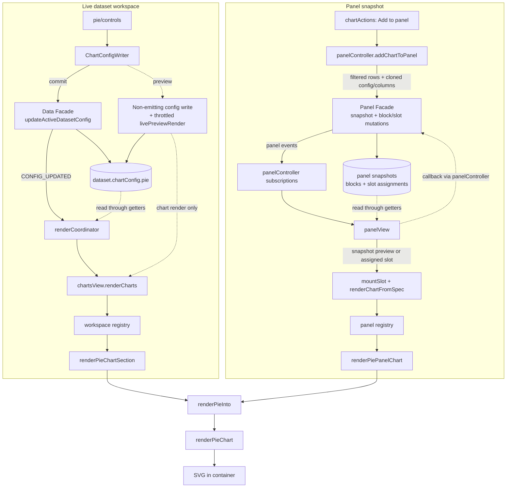

# The Pie / Donut Chart, end to end

This document explains how CHIVE's pie/donut chart works, from the config a dataset stores,
through the sidebar controls, into the renderer, and out to the panel/export paths. It is
meant to be read top to bottom the first time and used as a reference afterwards. File
links are relative to this document (which lives in `docs/development/charts/`).

Section 2 covers the geometry and encoding ideas the chart rests on (angle as a share of a
whole), independent of this codebase; everything from section 3 onward is how CHIVE
implements it.

For the high-level "which columns does it need" summary, see the pie row in
[Chart and data reference](../../user/chart-reference.md). For the shared state/panel/event architecture,
see [Architecture reference](../architecture-reference.md).

Key files:

- Renderer: [renderers/svg.js](../../../src/charts/pie/renderers/svg.js)
- Sidebar controls: [builder.js](../../../src/charts/pie/controls/builder.js),
  [listeners.js](../../../src/charts/pie/controls/listeners.js), and
  [activationDefaults.js](../../../src/charts/pie/controls/activationDefaults.js)
- Sectors and options: [data.js](../../../src/charts/pie/data.js) (`computePieSectors`, the
  sectors as drawn) and [options.js](../../../src/charts/pie/options.js)
- Chart definition and constants: [pie.js](../../../src/config/charts/definitions/pie.js) (`PIE_DEFINITION`, `PIE_CHART`)
- Per-dataset config defaults: [pie.js](../../../src/config/charts/definitions/pie.js) (the definition's fresh `pie` factory)
- Shared presentation mapping: [presentation.js](../../../src/charts/pie/presentation.js)
- Section adapter (dataset workspace): [workspaceSection.js](../../../src/charts/pie/workspaceSection.js)
- Panel adapter (saved snapshots): [panelAdapter.js](../../../src/charts/pie/panelAdapter.js)
- Shade math: [color.js](../../../src/charts/pie/color.js) (`buildSliceColor`)

---

## 1. What a pie / donut chart is

A pie chart shows part-to-whole composition: each category becomes a wedge whose angle is
proportional to that category's share of the total. A donut is the same chart with a hole in
the middle (a non-zero inner radius). Like the bar chart it is an **aggregating** chart
(count or sum per category), but it encodes magnitude as **angle** rather than length, which
is good for "what fraction of the whole" but weaker than bars for precise comparison between
similar slices.

CHIVE's version adds Top-N trimming (with an "Other" rollup), inside or outside labels with
leader lines, a legend, zoom/pan, per-slice color overrides, and the shared click-to-filter
tooltips.

---

## 2. Foundations: angle as a share of the whole

### 2.1 The aggregation behind the wedges

The category column partitions the rows; each group is reduced to a single number by the
**measure mode**: `count` (rows per category) or `sum` (total of a numeric value column).
Missing cells collapse to one "(missing)" group, kept apart from text that reads "N/A". This is the same count/sum vocabulary
the bar chart uses (see the bar doc's [section 2.2](bar.md)); the pie just omits
`mean`, because a mean has no meaningful "share of total."

### 2.2 From value to angle

Each slice's angle is its value's fraction of the grand total of the drawn sectors, swept
around the full circle:

```
sliceAngle = (value / total) · 2π
```

So the wedges sum to a full turn, which is exactly why a pie reads as "parts of one whole." A
wedge needs a value above 0, so in sum mode a category whose total is 0 or less gets no wedge
(section 7.1). The `pie()` layout generator turns the sorted values into start/end angles, and
the `arc()` generator turns each angle pair plus an inner and outer radius into an SVG path.

### 2.3 Donut, pad angle, and radius

- **Inner radius = 0** gives a classic pie; **inner radius > 0** gives a donut. The hole
  trades the (hard-to-read) center area for a cleaner look and room for a central label.
- **Pad angle** inserts a small gap between adjacent wedges, which helps separate many thin
  slices visually.
- The outer radius is clamped to what fits the container, and the inner radius is kept at
  least 8px below the outer so a donut never collapses to a ring of zero width.

### 2.4 Top-N and the "Other" rollup

Pies degrade badly with many categories (dozens of slivers). Top-N keeps only the largest N
categories, in one of two modes:

- **truncate**: simply drop everything past rank N (the remainder is not shown, so the
  visible wedges no longer sum to the true whole).
- **other**: keep the top N and roll the remainder into a single **"Other"** wedge, so the
  circle still represents 100% of the data. This is the more honest default for
  part-to-whole.

### 2.5 Labeling small slices

A label on a sliver is unreadable, so the renderer only labels slices above a minimum angular
share (about 4% for inside labels, 3% for outside labels with leader lines). Outside labels
get a polyline connector from the wedge to the text so they do not overlap the arc.

---

## 3. The big picture (data flow)

Two draw paths converge in `renderPieInto` and end at `renderPieChart`.



The renderer is **stateless**: each call wipes the container and rebuilds the SVG. Rows are
already global-filtered; the renderer aggregates on top of them. Panel config, rows, and
columns are detached `structuredClone` captures (see
[Architecture reference](../architecture-reference.md)).

---

## 4. The data model

### 4.1 Where config lives

`chartConfig.pie` is the pie slice of each dataset's `chartConfig`, built fresh by
`createDefaultChartConfig()` in
[defaults.js](../../../src/config/charts/defaults.js) and merged by
`mergeChartConfigWithDefaults()` in
[chartConfig.js](../../../src/domain/charts/chartConfig.js).

### 4.2 The `chartConfig.pie` keys

| Key | Meaning | Default |
|---|---|---|
| `enabled` / `expanded` | Shown at all / sidebar expanded | `false` / `false` |
| `category` | Categorical column bound to the wedges | `null` |
| `measureMode` | `'count'` or `'sum'` | `'count'` |
| `valueColumn` | Numeric column summed in sum mode | `null` |
| `innerRadius` / `outerRadius` | Donut hole / wedge radius in px | `0` / `100` |
| `padAngle` | Gap between wedges, in degrees | `0` |
| `zoomScale` | Current zoom multiplier | `1` |
| `topN` | Keep N largest categories (0 = all) | `0` |
| `topNMode` | `'other'` (rollup) or `'truncate'` | `'other'` |
| `color` | Base color slices are derived from | `CHART_COLORS.pie` (`#5f7c33`) |
| `customSliceColors` | Per-category color overrides (`{ categoryKey: hex }`) | `{}` |
| `colorScheme` | Named palette last applied | `'Colorblind-Safe'` |
| `showCategoryLabel` / `showValueLabel` / `showLegend` | Label and legend toggles | `true` |
| `labelPosition` | `'inside'` or `'outside'` | `'inside'` |
| `customTitle` / `chartHeight` | Title / SVG height (220 to 720) | `''` / `360` |

### 4.3 The constants behind the defaults

[pie.js](../../../src/config/charts/definitions/pie.js): the pie color is `#5f7c33`;
`CHART_DIMENSIONS.pie` = 700x360 with 16px margins; `CHART_HEIGHT_LIMITS.pie` =
`{ min: 220, max: 720 }`; `PIE_CHART` holds the radius bounds (`minOuterRadius: 20`,
`maxOuterRadius: 140`), pad-angle bounds (0 to 12 degrees), zoom bounds (0.3 to 4),
`otherSliceColor: '#9c9690'`, and the measure/top-N option lists.

---

## 5. The control sidebar

The controls package separates
[`createPieChartControls`](../../../src/charts/pie/controls/builder.js),
[`setupPieChartControlListeners`](../../../src/charts/pie/controls/listeners.js), and
[`computeDefaults`](../../../src/charts/pie/controls/activationDefaults.js) by role. The controls
registry imports those three entry points directly.

### 5.1 The three sections

1. **Data & aggregation** (expanded): category select, measure (count/sum), value-column
   select, Top-N select, Top-N mode (other/truncate).
2. **Display** (expanded): inner/outer radius sliders, pad-angle slider, zoom slider,
   category/value label toggles, legend toggle, title, label-position select, and a Reset
   Zoom button.
3. **Styling** (collapsed): the base color input, and (only when the chart has sectors to
   color) the palette-preset buttons and the **per-slice color picker grid**.

### 5.2 Enable/disable and conditional rendering

- Everything is disabled when `!config.enabled`.
- The value-column select is disabled in `count` mode.
- The palette presets and per-slice grid render only when the category column yields at least
  one sector (`getPieSectorValues` returns all source categories from
  `aggregatePieCategories`, descending by aggregate with a stable tiebreaker). Neither Top-N
  nor the rule that a wedge needs a value above 0 (section 7.1) is applied to this color list,
  so hidden categories retain their overrides, and so does a category whose total is 0 or
  less, since a global filter can leave its total above 0. The Other sector is not a
  category, so it has no swatch.
- Each swatch shows the color the chart draws that category with: `getPieSwatchColors` takes
  the fills from `computePieSectors` over the globally filtered rows, the same function the
  renderer draws from. A category the chart does not draw, because the global filter hides
  it, it falls past Top-N or its total is 0 or less, shows its override, or the grid's neutral
  gray when it has none.

### 5.3 Listener wiring and cross-constraints

Beyond the shared select/checkbox/text/color helpers, the pie has several custom listeners:

- **Measure**: switching to sum auto-picks the first numeric value column if none is set.
- **Inner/outer radius**: cross-constrained so the inner radius is always kept at least 8px
  below the outer (adjusting one can clamp the other).
- **Reset Zoom**: resets both the zoom slider DOM and `zoomScale` to the default.
- **Palette presets**: map an N-color palette across the N sectors by writing
  `customSliceColors` for each (not a single gradient). A palette stays marked only while
  every sector keeps the color its button gave it.
- **Per-slice color grid**: each swatch writes through the non-emitting facade on `input`
  (live drag preview, no sidebar rebuild) and commits through the emitting facade on `change`,
  the same live-preview discipline the TIN color picker uses (TIN doc [section 10](tin.md)).

---

## 6. The render entry chain

### 6.1 Dataset workspace

`renderPieChartSection({ config, rows, filterCallbacks })`
([workspaceSection.js](../../../src/charts/pie/workspaceSection.js)) resolves
the block/container, hides+clears when disabled, sets the min-height, maps config into the
shared presentation flow (with localized labels including the `Other` label), and calls the
renderer.
On failure it shows `chive-chart-empty-pie-sum` for `no-value-column` and `no-numeric`,
`chive-chart-empty-no-positive-sum` for `no-positive-value`, else `chive-chart-empty-pie`.

### 6.2 Panel view

The panel registry dispatches to
[`renderPiePanelChart`](../../../src/charts/pie/panelAdapter.js), which sends
`spec.config` and `spec.dataSnapshot` through the same presentation flow with empty
`filterCallbacks` (no click-to-filter in panels).

---

## 7. Inside `renderPieChart`

[`renderPieChart`](../../../src/charts/pie/renderers/svg.js)
`(container, rows, categoryColumn, options = {})` returns a `Result`.

### 7.1 Guard, options, aggregation

Returns `fail()` if container or category is missing. Options are clamped (colors validated,
radii/pad-angle/zoom clamped to `PIE_CHART` bounds, height to 220 to 720, title to 80 chars).

`computePieSectors` in [data.js](../../../src/charts/pie/data.js) then returns the sectors
the renderer draws, in drawn order, each `{ key, label, token, value, color, isOther }`, plus
their `total`. It reads the options through `normalizePieOptions` itself, so the saved config
the color controls pass and the renderer's options bag give the same sectors. The shared
`aggregateCategories`
([categoryAggregation.js](../../../src/charts/shared/categoryAggregation.js)) aggregates
count or sum per category; any measure other than sum counts rows (`aggregatePieCategories`).
Sum reads only number cells and needs a `valueColumn` that the rows carry. Categories come
back sorted descending by value with a `compareCategoryKeys` tiebreaker (missing last). Sum
mode without a usable value column → `fail('no-value-column')`, without a number →
`fail('no-numeric')`; count mode with no rows → `fail()`.

`computePieSectors` keeps only the categories whose value is above 0, since D3's pie layout
gives no angle to a value at or below 0. Only a sum can be 0 or less. With no category left →
`fail('no-positive-value')`.

### 7.2 Top-N

When `topN > 0` and there are more categories above 0 than N: in `truncate` mode the list is
cut to N; in `other` mode the top N are kept and the rest, all above 0, are summed into the
Other sector, drawn last: the reserved key `OTHER_SECTOR_KEY`, the localized Other label, no
category token, and `isOther: true`. The reserved key keeps a real category spelled like the
Other label apart from the rollup.

### 7.3 Geometry

The center and a fitted `maxRadius` are computed from the container size and margins. The
`pie()` generator (with `sort(null)` so the pre-sorted order is preserved, and the configured
`padAngle`) produces start/end angles; `arc()` with the clamped inner/outer radii draws the
wedge paths. A separate `labelArc` at 62% of the ring radius positions inside labels.

### 7.4 Wedges, color, and interaction

One `<path>` per slice. The wedge and its legend entry take the sector's `color`, which
`computePieSectors` resolves: the `Other` slice uses `PIE_CHART.otherSliceColor`; a category
with a `customSliceColors` override uses that; otherwise `buildSliceColor` gives it the base
color's shade for its position in the drawn order (section 8), so adjacent wedges are
distinguishable. Each wedge has a white stroke. Hover shows a category/value/percentage
tooltip; click pins the shared categorical filter-action tooltip (the bar doc's
[section 7.6](bar.md)), except for a sector with no category token, which only the `Other`
slice lacks: it pins a plain tooltip with no filter actions (it is an aggregate, not a real
category). The pin is tracked by sector key, so clicking the pinned wedge again unpins
it and clicking another wedge moves the pin.

### 7.5 Zoom, labels, and legend

A `d3.zoom` behavior on the SVG viewport supports scroll/drag zoom within the scale extent,
initialized to the saved `zoomScale`. Labels are drawn inside (at the label arc centroid) or
outside (with a leader polyline and edge-anchored text), skipping slices below the minimum
angular share. An optional legend lists the first 8 entries with color swatches. Returns
`ok()`.

---

## 8. The color system

- **Base + shade**: `buildSliceColor(base, index, count)` from
  [color.js](../../../src/charts/pie/color.js) darkens the base color 8% per step of the
  slice's position, down to 64% darker at the 9th slice, giving a monochrome family from one
  color. `count` is the number of sectors other than Other. Past 9, the same range is cut into
  one shade per slice, and those shades sit too close together for neighbors to take them in
  order. Even positions take the lighter half in order and odd positions the darker half, so
  each wedge stays about half the range from the ones beside it, including the last and first,
  which touch when there is no Other. No shade is lighter than the base color, so the white
  inside labels keep at least the base color's contrast. Past 81 slices with the default
  color, and sooner with a darker one, rounding to whole RGB values repeats some shades, but
  never on neighboring slices.
- **Per-slice overrides**: `customSliceColors[categoryKey]` wins over the shade for that
  category, set via the color grid or a palette preset.
- **Palette presets**: distribute a qualitative palette across the sectors (writing
  per-slice overrides), unlike the bar/scatter presets which seed a two-color gradient.
- **Other**: always the fixed `otherSliceColor` gray.
- **Shades follow the drawn order**: a global filter that hides a larger category moves
  every category below it up one position, to that position's shade. Past 9 slices the shades
  also depend on how many are drawn, so hiding a category or changing Top-N respreads them.
  The color grid follows the chart (section 5.2).

---

## 9. Performance notes

The pie emits one `<path>` per visible slice plus labels and a small legend, and Top-N bounds
the slice count, so it is light regardless of dataset size; the row-scaled work is the
sector pass used by rendering and, when the color controls rebuild, the category passes over
every row for the grid's order and a sector pass over the filtered rows for its swatches.
Base and per-slice color inputs use the shared throttled live-preview path.

---

## 10. Live preview and interaction

Base color and per-slice colors use the shared live-preview path: the non-emitting facade on
`input`, then an emitting commit on `change`. The per-slice color grid writes one sector's
override live and re-renders without rebuilding the sidebar, so dragging one swatch does not
disturb the others. Radius, pad-angle, and zoom sliders update their displayed value during
`input` and commit on `change`; the title also commits on `change`.

Zoom/pan and the click-to-filter pinned tooltips are the pie's interaction layer on top of
that.

---

## 11. SVG and export

Pure SVG: `<path>` wedges, `<polyline>` leaders, `<text>`/`<tspan>` labels, and a `<g>`
legend, all under a zoomable viewport `<g>`. The panel exporter clones the live `<svg>`;
there is no separate export path.

---

## 12. Invariants and edge cases

- **No category column** → `fail()`, the adapter shows `chive-chart-empty-pie` ("Select at
  least one visible categorical column to build the pie/donut chart.").
- **sum mode with no numeric value column** → `fail('no-value-column')`, or no number in it
  → `fail('no-numeric')`; both map to `chive-chart-empty-pie-sum` ("Select a visible numeric
  value column to render pie/donut in sum mode.").
- **Missing categories** collapse into a single "(missing)" wedge. Slice colors are keyed by
  category key, so a color saved under `'N/A'` before this change now applies only to a
  literal "N/A" category.
- **A real category spelled like the Other label** (for example "Other" in English or
  "Outros" in pt-BR) stays its own sector, with its own pin and color, apart from the rollup.
- **Top-N other** keeps the rendered positive-value circle at 100%; **truncate** does not.
- **Non-positive sum aggregates** are filtered out before Top-N (a wedge needs an angle), so
  they get no wedge or legend entry, take no share of the total and add nothing to the Other
  sector. With none left → `fail('no-positive-value')`, mapped to
  `chive-chart-empty-no-positive-sum` ("No category sums to more than 0 in the selected value
  column."). The per-slice color grid still lists them (section 5.2).
- **Inner radius** is always kept below the outer radius so a donut never inverts.
- **Tiny slices** are left unlabeled rather than drawing illegible text.
- **Stateless renders** and **detached panel captures** behave as for every chart (panel
  wedges carry no filter actions).

Empty-state strings live in [en.json](../../../src/i18n/en.json) (`chive-chart-empty-pie*`
and `chive-chart-empty-no-positive-sum`);
Portuguese equivalents in [pt-BR.json](../../../src/i18n/pt-BR.json).

---

## 13. Tests

- [renderEquivalence.test.js](../../../tests/charts/pie/renderEquivalence.test.js) pins the
  renderer's SVG and result output across representative options.
- [renderers/svg.test.js](../../../tests/charts/pie/renderers/svg.test.js) covers slices
  (one color each past 9 slices), labels, Top-N behavior, zoom, and pinned-tooltip filter
  states.
- [data.test.js](../../../tests/charts/pie/data.test.js) covers the drawn sectors: the rule
  that a sector needs a value above 0, Top-N, the Other sector, each sector's fill, and that
  the saved config and the renderer's options give the same sectors.
- [color.test.js](../../../tests/charts/pie/color.test.js) covers the base-color shade
  sequence (8% steps up to 9 slices, the alternating spread past 9) and its fallback.
- [sectorValues.test.js](../../../tests/charts/pie/sectorValues.test.js) covers the color-grid
  category order and the swatch colors under a global filter and Top-N.
- [controls.test.js](../../../tests/charts/pie/controls.test.js) covers control building, the
  radius cross-constraint, and the per-slice color logic.
- [workspaceSection.test.js](../../../tests/charts/pie/workspaceSection.test.js) and
  [panelAdapter.test.js](../../../tests/charts/pie/panelAdapter.test.js) cover both integration
  surfaces and their shared renderer contract.
- [panel.test.js](../../../tests/charts/registries/panel.test.js)
  covers the panel dispatch path.

---

## 14. Quick reference

**Element IDs** ([workspaceDomIds.js](../../../src/charts/workspaceDomIds.js)): container
`chart-pie-container`, block `chart-block-pie`. Control IDs are `viz-…-pie-…`
(e.g. `viz-select-pie-category`, `viz-slider-pie-inner-radius`,
`viz-select-pie-topn-mode`, `viz-pie-color-grid`).

**DOM structure** of a rendered pie chart:

```
<svg>
  <text>                    (optional title)
  <g> viewport (zoom/pan target)
    <g transform=center>
      <path> × N            (one per wedge, white stroke)
      <text>/<tspan>        (inside labels) OR <polyline> + <text> (outside labels)
  <g> legend                (first 8 entries, optional)
```

**Tuning knobs** ([pie.js](../../../src/config/charts/definitions/pie.js) `PIE_CHART`): radius bounds, pad-angle
bounds, zoom bounds, `otherSliceColor`, `defaultTopN`/`defaultTopNMode`.

**Foundations → implementation map:**

| Concept (section 2) | Implementation |
|---|---|
| Count/sum aggregation, missing bucket (2.1) | `aggregateCategories`, through `computePieSectors` (7.1) |
| Value → angle (2.2) | `pie()` + `arc()` generators (7.3) |
| Donut / pad / radius (2.3) | inner/outer radius clamp, `padAngle` (7.1, 7.3) |
| Top-N + Other rollup (2.4) | the Top-N branch of `computePieSectors` (7.2) |
| Small-slice labeling (2.5) | angular-share filter on labels (7.5) |
